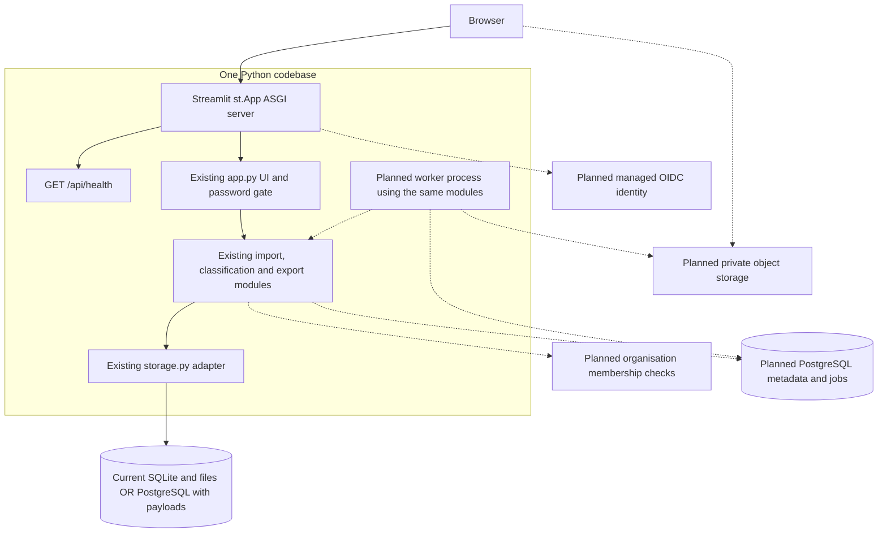

# Vendor Document Dashboard architecture

Status: architecture and scaffold, 2026-10-19. This is an incremental Python modular monolith, not a rewrite or a deployed multi-tenant SaaS.

## Inputs and boundaries

`docs/system-design.md` was not present when this document was written. Inputs are the inspected root dashboard, the supplied deployment checklist, and the conversation's provisional capacity scenario. This document does not invent confirmed business requirements. Organisation roles, billing plans, data residency, retention, recovery objectives and availability commitments remain open.

The user requested architecture/decision records followed by a scaffold, without feature implementation. The scaffold keeps existing root modules and their public imports working. Only package boundaries, developer tooling and a public liveness endpoint are added. No identity integration, tenant schema, queue, worker consumer, object-store adapter, payment integration or migration runs in this change. Existing imports remain synchronous and existing files remain in SQLite/filesystem or PostgreSQL payloads.

Provisional year-one planning inputs: 20 organisations, 10 users each, 40 active simultaneously, 5 imports/organisation/month, 100 new documents/import, 2 MiB/document and one-year retention. This means 1,200 imports/year, 120,000 documents/year and 234.4 GiB (251.7 decimal GB) of files. With 20% of documents producing 50 rows, expect 1.2 million extracted rows and approximately 3 GiB indexed metadata. Four user actions/second and an assumed three operations/action give 12 server-operation equivalents/second, not measured HTTP RPS. These are sizing assumptions, not load-test results.

## Component diagram

Solid edges show the scaffold/current runtime. Dashed edges show the intended SaaS additions, which are not implemented.



The future worker is a second process of the same application and release, not an independently designed microservice. There is one database and no internal HTTP hop between business modules.

## Stack choices and alternatives

| Layer | Choice | Alternative and why deferred/rejected |
| --- | --- | --- |
| Language | Python 3.12, matching CI/container | TypeScript rewrite would duplicate established parsing/storage behavior and expand the toolchain |
| UI | Existing Streamlit 1.63.0 | React/Next.js adds a frontend build and a separate API contract before product flows are settled |
| HTTP server | Native `st.App` with a Starlette GET route, same process/port | Separate FastAPI server duplicates lifecycle/hosting for one health endpoint |
| Business logic | Existing modules; new work enters `vendor_dashboard` package boundaries | Microservices add network failures, deployments and tracing without independent teams or scaling needs |
| Metadata | Existing psycopg + managed PostgreSQL in production; SQLite locally | New ORM/database replacement adds migration risk; no new ORM is needed for the scaffold |
| File bytes | Preserve current storage now; private Cloudflare R2 Standard is the target before the assumed 234 GiB dataset | Keeping every file in PostgreSQL long term increases backup/database footprint; moving bytes now would exceed scaffold scope |
| Identity/tenancy | Target: Streamlit OIDC with Clerk as managed issuer, plus application-owned memberships and tenant checks | Shared password is retained only for the existing internal dashboard; building password recovery/MFA ourselves adds security work |
| Jobs | Target: PostgreSQL jobs table + one polling Python worker from this codebase | Celery + Redis introduces another datastore and delivery model for approximately 100 imports/month |
| Hosting | Target: managed Render web service, worker and PostgreSQL in a chosen common region | Kubernetes/self-managed VPS adds patching, networking, database recovery and deployment operations |
| Diagnostics | Standard Python/server logs and provider metrics; job IDs and redacted structured events when jobs exist | A mandatory external observability stack is premature; add one when logs/alerts cannot answer operating questions |
| Quality | Ruff lint + formatter; mypy strict on new package/launcher; pytest | ESLint/tsc do not check Python; repository-wide legacy reformat/type retrofit would bury this scaffold in unrelated edits |

`starlette` is already a Streamlit runtime dependency; declaring it directly documents the new direct import without changing the supported version range. Ruff and mypy are development-only additions requested by the scaffold. No auth/storage/worker SDK is installed until that feature is implemented.

## Repository structure

Paths below are created or retained by this scaffold. Package marker files reserve boundaries; they are not working feature implementations. Existing application modules stay at the root until focused, tested moves are approved.

```text
.
|-- asgi_app.py                 # launcher: native ASGI wrapper around app.py
|-- app.py                      # existing Streamlit UI; no feature rewrite
|-- vendor_core.py              # existing classification/archive/checklists
|-- import_service.py           # existing synchronous import orchestration
|-- storage.py                  # existing database/file persistence
|-- exports.py
|-- drive_import.py
|-- catalogue_extraction.py
|-- vendor_dashboard/
|   |-- __init__.py
|   |-- web/
|   |   |-- __init__.py
|   |   |-- application.py      # routes supplied to launcher's st.App
|   |   `-- health.py           # no data access or credentials
|   |-- domain/__init__.py      # reserved pure business rules
|   |-- services/__init__.py    # reserved use-case orchestration
|   |-- infrastructure/__init__.py # reserved database/object-store adapters
|   `-- jobs/__init__.py        # reserved durable worker integration
|-- tests/
|   |-- test_health.py          # real wrapper server, JSON/method/storage checks
|   |-- test_deploy_bundle.py   # extracted bundle imports, including wrapper
|   `-- ...                    # existing dashboard regressions retained
|-- requirements.txt           # runtime dependencies
|-- requirements-dev.txt       # runtime + pytest, Ruff, mypy
|-- pyproject.toml             # Python quality configuration
|-- .env.example               # documented current application variables
|-- .streamlit/                # theme, request limits, safe secrets example
|-- .github/workflows/         # existing CI + focused scaffold checks
|-- docs/
|   |-- architecture.md
|   `-- decisions/             # numbered ADRs
|-- Dockerfile
|-- docker-compose.yml
|-- build_deploy_bundle.py
|-- README.md
|-- AGENTS.md
|-- CLAUDE.md
`-- data-organizer/            # separate existing application; unchanged
```

Dependency direction for future modules: web/jobs -> services -> domain; infrastructure implements persistence/external access used by services. Domain does not import Streamlit, requests or database drivers. Do not copy root logic into empty packages; move it with tests when there is a concrete reason.

## Background jobs: design, not scaffold functionality

Run one managed background worker using the same release and business modules as the web process. It polls PostgreSQL every two seconds with jitter, atomically claims a ready job with `FOR UPDATE SKIP LOCKED`, records a lease, commits the claim, then processes outside the claim transaction. Start with concurrency one. Leases/heartbeats allow another worker to recover abandoned work; retries are at-least-once, with capped exponential backoff and a maximum of three attempts before manual review.

A future job record needs organisation ID, job ID, idempotency key, input object key, status, attempts, lease owner/expiry, timestamps, progress counts and a redacted error code. Use pending/running/partial/succeeded/failed/cancelled states. Write progress at bounded intervals. Recheck organisation access at submission and result retrieval; a worker scopes every storage operation to the recorded tenant. Honour SIGTERM by stopping claims and checkpointing or allowing the lease to expire. Cap extraction time, temporary disk, per-file/expanded sizes and job concurrency; keep existing ZIP/Drive safeguards.

Uploads must finish storing a validated input object before enqueueing. Idempotency must be scoped to tenant + intended operation. Existing global content-hash deduplication must not become a cross-tenant existence oracle. Object writes and SQL commits need retryable reconciliation; never report completion before durable writes finish. No queue table or worker executable is created now, because that would implement an import feature and change the schema.

## Security, data flow and operation

Before admitting unrelated customers, implement individual login and server-side organisation membership checks throughout services, object access, downloads, exports, backups, jobs and cache keys. Use issuer + subject as identity, not a client-supplied email or organisation ID. OIDC proves identity; database membership determines access. Default intended roles are owner and member; exact privileges are unresolved and must be specified before implementation. Require explicit active-organisation selection and reject missing membership. Global reset must not be customer-accessible.

Clerk can act as an OAuth/OIDC issuer; Streamlit supports OIDC. Callback metadata, logout/session expiry, membership revocation and user provisioning still require an isolated integration spike before committing to the provider. Existing shared-password authentication is unchanged by this scaffold and is insufficient for shared customer hosting.

Future private object keys use tenant/document identifiers, not raw upload paths. Authorize before issuing short-lived signed URLs; restrict upload key, size and expiry, and validate actual bytes before acceptance. Keep credentials server-side. Region, personal data categories, retention, malware scanning needs, object recovery and erasure through backup expiry remain open. Do not expose public buckets or log document bodies, filenames containing personal data, passwords or connection strings.

`GET /api/health` returns HTTP 200 with `{"status":"ok"}` and `Cache-Control: no-store`. It is intentionally unauthenticated and reports process liveness only, not database/storage readiness, successful imports or tenant security. It performs no storage initialization. GET and HEAD are supported; other methods return 405. Existing Streamlit routes remain intact. Health checks do not replace authenticated UI tests.

Keep the literal `st.App(...)` constructor in `asgi_app.py`: Streamlit's CLI statically discovers known ASGI constructors and does not follow a custom factory function. A factory-only launcher can silently serve the UI shell at `/api/health`. The live-server regression test must require JSON, not just HTTP 200.

Configuration remains Streamlit secrets first, environment second; `.env` is not automatically loaded. Existing `app.py` can still be run directly, but `/api/health` requires `asgi_app.py`. Docker and the deployment bundle use the wrapper. The new route must not return configuration, dependency versions or storage state.

Start with one web instance and one future worker. Target a bounded pilot before any SLA; proposed initial operating goals are p95 ordinary interactions under two seconds on the synthetic target dataset, queued-job start within 30 seconds when idle, RPO at most 24 hours and restore within four hours. These are proposals to validate, not guarantees. Run an actual representative PDF/OCR/import/concurrency benchmark and an isolated restore drill before publishing capacity or availability promises. Replace memory-built full backups with database/provider recovery plus independently recoverable objects before large datasets. Plan tenant-scoped SQL migrations separately with versioning, backfill, verification and rollback; none is executed here.

## Services and estimated costs

Price research date: 2026-10-19. USD/month, before taxes, domain, workspace upgrades, bandwidth overages and independent backup copies. No service is provisioned by this task. This is a target SaaS budget after future integrations, not the cost of the local scaffold.

| Service | Assumed target usage | Planning amount |
| --- | --- | --- |
| Render web | One `1c-2g` process, 1 CPU / 2 GB | $25/month, published pricing search extract; verify live checkout |
| Render worker | One `1c-2g` process, concurrency one | $25/month when the worker feature is enabled; $0 worker cost for this scaffold |
| Render PostgreSQL | `0.5c-1g`, provision 10 GB metadata/jobs capacity | $19 compute + budget $2.70 storage = $21.70/month; verify included capacity and backup window |
| Cloudflare R2 Standard | 251.7 GB at year end, 10 GB free; <=1 million Class A and <=10 million Class B/month | Rounded billable 242 GB x $0.015 = $3.63/month at year end; approximately $1.75/month average with linear first-year growth |
| Clerk | 200 retained users, identity only; memberships in our database | $0 within current Hobby allowance; verify OAuth app eligibility and production needs before integration |
| Logging/metrics | Provider logs/metrics within included retention | $0 additional budget; retention/alert limitations must be checked |
| Public Google Drive import | Existing optional external download source | No paid API integration selected; quotas/availability remain outside our control |
| Billing/email | No selected plans, billing flow or notification requirements | Deferred; no payment or email service subscribed |

Target base run rate at year end: $25 + $25 + $21.70 + $3.63 = **$75.33/month**, rounded to a **$80/month base budget**. This is not an all-inclusive invoice. Render workspace/bandwidth/backup charges can change it. A separate full object backup copy adds storage charges. Current PostgreSQL document payloads are not included in the metadata-only target; until migrated, roughly 237 GiB logical database data would need a much larger database storage budget.

Render's main live page did not expose price amounts through the reader; dollar figures above were available in an indexed official pricing extract, so they require checkout verification. Current official compute documentation confirms the plan sizes. R2 and Clerk amounts were readable on their official pricing pages. None of these small instances is demonstrated to sustain 40 concurrent heavy sessions or 2 GB browser uploads. Budget larger compute only after representative profiling; keep pilot upload limits conservative. Regions and supplier terms must be chosen before real customer data is hosted.

Sources: [Render pricing](https://render.com/pricing), [Render compute plans](https://render.com/docs/compute-plans), [R2 pricing](https://developers.cloudflare.com/r2/pricing/), [Clerk pricing](https://clerk.com/pricing), [Clerk OAuth/OIDC implementation](https://clerk.com/docs/guides/configure/auth-strategies/oauth/how-clerk-implements-oauth), [Streamlit OIDC](https://docs.streamlit.io/develop/concepts/connections/authentication). The installed Streamlit 1.63 reference `references/server-asgi.md` verifies native `st.App` custom routes. [Ruff configuration](https://docs.astral.sh/ruff/configuration/) and [mypy configuration](https://mypy.readthedocs.io/en/stable/config_file.html) inform developer checks.

## Three riskiest decisions

1. **Evolving a single-dataset dashboard into tenant-safe SaaS.** Existing queries, deduplication, reset and caches are global. Identity alone does not fix this. Gate customer launch on tenant-scoped migrations and negative isolation tests for every data path, including asynchronous work and downloads.
2. **Keeping Streamlit for an upload-heavy multi-user product.** Sessions, reruns, memory-backed uploads and newly adopted ASGI integration need realistic tests. Run one instance initially, profile concurrent imports, test login/session behavior under the wrapper and set measured resource limits. Reconsider a separate frontend only when actual UX/load constraints justify the cost.
3. **Splitting metadata, bytes and job progress across stores.** Object/SQL writes are not one transaction; backups must restore consistent references. Introduce idempotency, reconciliation, checksum verification and restore drills before migration. Keep old bytes until verified retrieval and an approved rollback window have passed.

## Scaffold verification and remaining work

Python strict checking covers `vendor_dashboard/` and `asgi_app.py`; legacy root modules are not claimed strict or reformatted. Ruff covers that same surface. Repository-wide verification runs root dashboard tests and the complete `data-organizer/tests` suite in separate CI jobs, dependency environments and working directories, as recorded in [ADR 0008](decisions/0008-isolated-application-tests.md). Organizer CI installs Tesseract/English data and fonts for its OCR tests. A single root pytest process is not the supported combined check because application imports and pandas/pytest pins conflict. Neither suite may be omitted to conceal failures. A dedicated scaffold CI workflow also runs quality checks and root regressions.

Run the wrapper locally and request `/api/health`; separately run existing Streamlit AppTest tests. Package the new wrapper and package files in deployment artifacts and verify imports without the source checkout. Docker build/start verification requires a working Docker engine; an unavailable engine is reported as blocked. No cloud deployment, production PostgreSQL, object storage, auth, background processing or load testing is implied by local liveness.

ADRs: [0001 monolith](decisions/0001-python-modular-monolith.md), [0002 ASGI](decisions/0002-native-asgi-health.md), [0003 storage](decisions/0003-metadata-and-private-objects.md), [0004 jobs](decisions/0004-postgres-worker.md), [0005 identity](decisions/0005-identity-and-tenancy.md), [0006 hosting](decisions/0006-managed-hosting.md), [0007 tooling](decisions/0007-incremental-strict-tooling.md), [0008 isolated tests](decisions/0008-isolated-application-tests.md).
