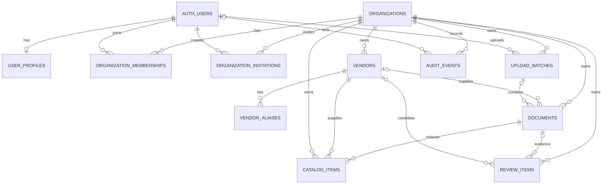

# Proposed tenant database schema

This is the design deliverable for section 3a. It is **not a migration** and
must be approved before implementation or execution. The repository currently
uses direct SQL and has no ORM, so the schema is expressed as PostgreSQL DDL,
not in an ORM format. `auth.users` is managed by Supabase and is referenced,
not recreated.

## Entity relationship diagram



`BACKUP_RUNS` is platform-wide operational metadata, not tenant data. The
managed `auth.users` table is outside the application schema.

## PostgreSQL DDL proposal

```sql
CREATE TABLE organizations (
    id uuid PRIMARY KEY DEFAULT gen_random_uuid(),
    name text NOT NULL CHECK (length(trim(name)) > 0),
    slug text NOT NULL CHECK (slug ~ '^[a-z0-9]+(-[a-z0-9]+)*$'),
    created_at timestamptz NOT NULL DEFAULT now(),
    updated_at timestamptz NOT NULL DEFAULT now(),
    deleted_at timestamptz
);

CREATE UNIQUE INDEX organizations_active_slug_uq
    ON organizations (slug) WHERE deleted_at IS NULL;
CREATE INDEX organizations_active_name_idx
    ON organizations (lower(name), id) WHERE deleted_at IS NULL;

CREATE TABLE user_profiles (
    id uuid PRIMARY KEY REFERENCES auth.users(id) ON DELETE CASCADE,
    display_name text NOT NULL DEFAULT '' CHECK (length(display_name) <= 200),
    created_at timestamptz NOT NULL DEFAULT now(),
    updated_at timestamptz NOT NULL DEFAULT now()
);

CREATE TABLE organization_memberships (
    id uuid PRIMARY KEY DEFAULT gen_random_uuid(),
    organization_id uuid NOT NULL REFERENCES organizations(id),
    user_id uuid NOT NULL REFERENCES auth.users(id),
    role text NOT NULL CHECK (role IN ('Owner', 'Admin', 'Member', 'Viewer')),
    created_at timestamptz NOT NULL DEFAULT now(),
    updated_at timestamptz NOT NULL DEFAULT now(),
    deleted_at timestamptz,
    UNIQUE (organization_id, id)
);

CREATE UNIQUE INDEX organization_memberships_active_user_uq
    ON organization_memberships (organization_id, user_id)
    WHERE deleted_at IS NULL;
CREATE INDEX organization_memberships_org_fk_idx
    ON organization_memberships (organization_id);
CREATE INDEX organization_memberships_user_idx
    ON organization_memberships (user_id, organization_id);
CREATE INDEX organization_memberships_org_role_idx
    ON organization_memberships (organization_id, role)
    WHERE deleted_at IS NULL;

CREATE TABLE organization_invitations (
    id uuid PRIMARY KEY DEFAULT gen_random_uuid(),
    organization_id uuid NOT NULL REFERENCES organizations(id),
    invited_by uuid NOT NULL REFERENCES auth.users(id),
    email text NOT NULL CHECK (email = lower(trim(email))),
    role text NOT NULL CHECK (role IN ('Admin', 'Member', 'Viewer')),
    token_hash text NOT NULL UNIQUE,
    expires_at timestamptz NOT NULL,
    accepted_at timestamptz,
    created_at timestamptz NOT NULL DEFAULT now(),
    updated_at timestamptz NOT NULL DEFAULT now(),
    deleted_at timestamptz,
    CHECK (expires_at > created_at),
    UNIQUE (organization_id, id)
);

CREATE UNIQUE INDEX organization_invitations_pending_email_uq
    ON organization_invitations (organization_id, email)
    WHERE accepted_at IS NULL AND deleted_at IS NULL;
CREATE INDEX organization_invitations_org_fk_idx
    ON organization_invitations (organization_id);
CREATE INDEX organization_invitations_inviter_idx
    ON organization_invitations (invited_by);
CREATE INDEX organization_invitations_expiry_idx
    ON organization_invitations (expires_at)
    WHERE accepted_at IS NULL AND deleted_at IS NULL;

CREATE TABLE vendors (
    id uuid PRIMARY KEY DEFAULT gen_random_uuid(),
    organization_id uuid NOT NULL REFERENCES organizations(id),
    company_key text NOT NULL CHECK (length(trim(company_key)) > 0),
    canonical_code text NOT NULL CHECK (length(trim(canonical_code)) > 0),
    company_name text NOT NULL CHECK (length(trim(company_name)) > 0),
    source text NOT NULL DEFAULT 'auto',
    created_at timestamptz NOT NULL DEFAULT now(),
    updated_at timestamptz NOT NULL DEFAULT now(),
    deleted_at timestamptz,
    UNIQUE (organization_id, id)
);

CREATE UNIQUE INDEX vendors_active_company_key_uq
    ON vendors (organization_id, company_key) WHERE deleted_at IS NULL;
CREATE UNIQUE INDEX vendors_active_canonical_code_uq
    ON vendors (organization_id, canonical_code) WHERE deleted_at IS NULL;
CREATE INDEX vendors_active_name_idx
    ON vendors (organization_id, lower(company_name), id) WHERE deleted_at IS NULL;
CREATE INDEX vendors_organization_fk_idx
    ON vendors (organization_id);

CREATE TABLE vendor_aliases (
    id uuid PRIMARY KEY DEFAULT gen_random_uuid(),
    organization_id uuid NOT NULL REFERENCES organizations(id),
    vendor_id uuid NOT NULL,
    alias_key text NOT NULL CHECK (length(trim(alias_key)) > 0),
    alias_name text NOT NULL CHECK (length(trim(alias_name)) > 0),
    source text NOT NULL DEFAULT '',
    confidence smallint NOT NULL DEFAULT 100 CHECK (confidence BETWEEN 0 AND 100),
    status text NOT NULL DEFAULT 'Confirmed'
        CHECK (status IN ('Confirmed', 'Likely Match', 'Review Required', 'Rejected')),
    created_at timestamptz NOT NULL DEFAULT now(),
    updated_at timestamptz NOT NULL DEFAULT now(),
    deleted_at timestamptz,
    UNIQUE (organization_id, id),
    FOREIGN KEY (organization_id, vendor_id)
        REFERENCES vendors (organization_id, id)
);

CREATE UNIQUE INDEX vendor_aliases_active_key_uq
    ON vendor_aliases (organization_id, alias_key) WHERE deleted_at IS NULL;
CREATE INDEX vendor_aliases_vendor_idx
    ON vendor_aliases (organization_id, vendor_id);
CREATE INDEX vendor_aliases_active_name_idx
    ON vendor_aliases (organization_id, lower(alias_name), id)
    WHERE deleted_at IS NULL;

CREATE TABLE upload_batches (
    id uuid PRIMARY KEY DEFAULT gen_random_uuid(),
    organization_id uuid NOT NULL REFERENCES organizations(id),
    uploaded_by uuid REFERENCES auth.users(id),
    filename text NOT NULL CHECK (length(trim(filename)) > 0),
    archive_object_key text,
    sha256 char(64) NOT NULL CHECK (sha256 ~ '^[0-9a-f]{64}$'),
    size_bytes bigint NOT NULL CHECK (size_bytes > 0),
    upload_count integer NOT NULL DEFAULT 1 CHECK (upload_count > 0),
    detected_vendors integer NOT NULL DEFAULT 0 CHECK (detected_vendors >= 0),
    processed_files integer NOT NULL DEFAULT 0 CHECK (processed_files >= 0),
    issues_count integer NOT NULL DEFAULT 0 CHECK (issues_count >= 0),
    status text NOT NULL DEFAULT 'Received'
        CHECK (status IN ('Received', 'Processing', 'Completed', 'Failed')),
    created_at timestamptz NOT NULL DEFAULT now(),
    updated_at timestamptz NOT NULL DEFAULT now(),
    deleted_at timestamptz,
    UNIQUE (organization_id, id),
    UNIQUE (organization_id, sha256),
    CHECK (
        archive_object_key IS NULL OR
        archive_object_key LIKE organization_id::text || '/%'
    )
);

CREATE INDEX upload_batches_active_created_idx
    ON upload_batches (organization_id, created_at DESC)
    WHERE deleted_at IS NULL;
CREATE INDEX upload_batches_uploader_idx
    ON upload_batches (uploaded_by);
CREATE INDEX upload_batches_active_status_idx
    ON upload_batches (organization_id, status, created_at DESC)
    WHERE deleted_at IS NULL;
CREATE INDEX upload_batches_organization_fk_idx
    ON upload_batches (organization_id);

CREATE TABLE documents (
    id uuid PRIMARY KEY DEFAULT gen_random_uuid(),
    organization_id uuid NOT NULL REFERENCES organizations(id),
    vendor_id uuid,
    upload_batch_id uuid,
    uploaded_by uuid REFERENCES auth.users(id),
    filename text NOT NULL CHECK (length(trim(filename)) > 0),
    source_path text NOT NULL DEFAULT '',
    storage_key text NOT NULL UNIQUE CHECK (length(trim(storage_key)) > 0),
    content_type text NOT NULL CHECK (length(trim(content_type)) > 0),
    sha256 char(64) NOT NULL CHECK (sha256 ~ '^[0-9a-f]{64}$'),
    size_bytes bigint NOT NULL CHECK (size_bytes > 0),
    document_types text[] NOT NULL DEFAULT '{}',
    handover text NOT NULL DEFAULT '',
    method text NOT NULL DEFAULT '',
    reason text NOT NULL DEFAULT '',
    reviewed boolean NOT NULL DEFAULT false,
    uploaded_at timestamptz NOT NULL DEFAULT now(),
    created_at timestamptz NOT NULL DEFAULT now(),
    updated_at timestamptz NOT NULL DEFAULT now(),
    deleted_at timestamptz,
    UNIQUE (organization_id, id),
    FOREIGN KEY (organization_id, vendor_id)
        REFERENCES vendors (organization_id, id),
    FOREIGN KEY (organization_id, upload_batch_id)
        REFERENCES upload_batches (organization_id, id),
    CHECK (storage_key LIKE organization_id::text || '/%')
);

CREATE UNIQUE INDEX documents_active_vendor_hash_uq
    ON documents (organization_id, vendor_id, sha256)
    WHERE vendor_id IS NOT NULL AND deleted_at IS NULL;
CREATE UNIQUE INDEX documents_active_unassigned_hash_uq
    ON documents (organization_id, sha256)
    WHERE vendor_id IS NULL AND deleted_at IS NULL;
CREATE INDEX documents_active_vendor_idx
    ON documents (organization_id, vendor_id, uploaded_at DESC)
    WHERE deleted_at IS NULL;
CREATE INDEX documents_batch_idx
    ON documents (organization_id, upload_batch_id);
CREATE INDEX documents_uploader_idx
    ON documents (uploaded_by);
CREATE INDEX documents_vendor_fk_idx
    ON documents (organization_id, vendor_id);
CREATE INDEX documents_active_uploaded_idx
    ON documents (organization_id, uploaded_at DESC, id)
    WHERE deleted_at IS NULL;
CREATE INDEX documents_active_review_idx
    ON documents (organization_id, reviewed, uploaded_at DESC)
    WHERE deleted_at IS NULL;

CREATE TABLE catalog_items (
    id uuid PRIMARY KEY DEFAULT gen_random_uuid(),
    organization_id uuid NOT NULL REFERENCES organizations(id),
    document_id uuid NOT NULL,
    vendor_id uuid,
    source_location text NOT NULL DEFAULT '',
    product_name text NOT NULL CHECK (length(trim(product_name)) > 0),
    category text NOT NULL DEFAULT '',
    brand text NOT NULL DEFAULT '',
    model text NOT NULL DEFAULT '',
    specifications text NOT NULL DEFAULT '',
    currency char(3) CHECK (currency IS NULL OR currency ~ '^[A-Z]{3}$'),
    unit_price_minor bigint CHECK (unit_price_minor IS NULL OR unit_price_minor >= 0),
    unit text NOT NULL DEFAULT '',
    pack_size numeric(20, 6) CHECK (pack_size IS NULL OR pack_size > 0),
    moq numeric(20, 6) CHECK (moq IS NULL OR moq >= 0),
    stock numeric(20, 6) CHECK (stock IS NULL OR stock >= 0),
    hsn_code text NOT NULL DEFAULT '',
    gst_rate numeric(5, 2) CHECK (gst_rate IS NULL OR gst_rate BETWEEN 0 AND 100),
    tax_basis text CHECK (tax_basis IS NULL OR tax_basis IN ('Inclusive', 'Exclusive')),
    availability text NOT NULL DEFAULT '',
    lead_time text NOT NULL DEFAULT '',
    delivery_terms text NOT NULL DEFAULT '',
    payment_terms text NOT NULL DEFAULT '',
    warranty text NOT NULL DEFAULT '',
    valid_until date,
    contact text NOT NULL DEFAULT '',
    email text NOT NULL DEFAULT '',
    phone text NOT NULL DEFAULT '',
    vendor_gstin text NOT NULL DEFAULT '',
    extra jsonb NOT NULL DEFAULT '{}',
    source_row integer CHECK (source_row IS NULL OR source_row > 0),
    created_at timestamptz NOT NULL DEFAULT now(),
    updated_at timestamptz NOT NULL DEFAULT now(),
    deleted_at timestamptz,
    UNIQUE (organization_id, id),
    FOREIGN KEY (organization_id, document_id)
        REFERENCES documents (organization_id, id),
    FOREIGN KEY (organization_id, vendor_id)
        REFERENCES vendors (organization_id, id),
    CHECK ((unit_price_minor IS NULL) = (currency IS NULL))
);

CREATE INDEX catalog_items_active_vendor_idx
    ON catalog_items (organization_id, vendor_id, product_name)
    WHERE deleted_at IS NULL;
CREATE INDEX catalog_items_document_fk_idx
    ON catalog_items (organization_id, document_id);
CREATE INDEX catalog_items_vendor_fk_idx
    ON catalog_items (organization_id, vendor_id);
CREATE INDEX catalog_items_active_currency_price_idx
    ON catalog_items (organization_id, currency, unit_price_minor)
    WHERE deleted_at IS NULL AND unit_price_minor IS NOT NULL;
CREATE INDEX catalog_items_active_category_idx
    ON catalog_items (organization_id, category, product_name)
    WHERE deleted_at IS NULL;
CREATE INDEX catalog_items_active_name_search_idx
    ON catalog_items USING gin
    (to_tsvector('simple', product_name || ' ' || specifications))
    WHERE deleted_at IS NULL;

CREATE TABLE review_items (
    id uuid PRIMARY KEY DEFAULT gen_random_uuid(),
    organization_id uuid NOT NULL REFERENCES organizations(id),
    document_id uuid,
    candidate_vendor_id uuid,
    detected_name text NOT NULL DEFAULT '',
    source text NOT NULL DEFAULT '',
    record text NOT NULL DEFAULT '',
    confidence smallint NOT NULL DEFAULT 0 CHECK (confidence BETWEEN 0 AND 100),
    evidence text NOT NULL DEFAULT '',
    status text NOT NULL DEFAULT 'Review Required'
        CHECK (status IN ('Review Required', 'Confirmed', 'Rejected')),
    decision text NOT NULL DEFAULT '',
    created_at timestamptz NOT NULL DEFAULT now(),
    updated_at timestamptz NOT NULL DEFAULT now(),
    deleted_at timestamptz,
    UNIQUE (organization_id, id),
    FOREIGN KEY (organization_id, document_id)
        REFERENCES documents (organization_id, id),
    FOREIGN KEY (organization_id, candidate_vendor_id)
        REFERENCES vendors (organization_id, id)
);

CREATE INDEX review_items_active_status_idx
    ON review_items (organization_id, status, created_at DESC)
    WHERE deleted_at IS NULL;
CREATE INDEX review_items_document_idx
    ON review_items (organization_id, document_id);
CREATE INDEX review_items_candidate_vendor_idx
    ON review_items (organization_id, candidate_vendor_id);

CREATE TABLE audit_events (
    id uuid PRIMARY KEY DEFAULT gen_random_uuid(),
    organization_id uuid NOT NULL REFERENCES organizations(id),
    actor_id uuid REFERENCES auth.users(id),
    action text NOT NULL CHECK (length(trim(action)) > 0),
    details jsonb NOT NULL DEFAULT '{}',
    created_at timestamptz NOT NULL DEFAULT now(),
    updated_at timestamptz NOT NULL DEFAULT now()
);

CREATE INDEX audit_events_org_created_idx
    ON audit_events (organization_id, created_at DESC, id);
CREATE INDEX audit_events_actor_idx
    ON audit_events (actor_id, created_at DESC);
CREATE INDEX audit_events_org_action_idx
    ON audit_events (organization_id, action, created_at DESC);

CREATE TABLE backup_runs (
    id uuid PRIMARY KEY DEFAULT gen_random_uuid(),
    status text NOT NULL CHECK (status IN ('Running', 'Succeeded', 'Failed')),
    storage_key text NOT NULL DEFAULT '',
    sha256 char(64) CHECK (sha256 IS NULL OR sha256 ~ '^[0-9a-f]{64}$'),
    started_at timestamptz NOT NULL DEFAULT now(),
    completed_at timestamptz,
    retained_until timestamptz,
    error_summary text NOT NULL DEFAULT '',
    created_at timestamptz NOT NULL DEFAULT now(),
    updated_at timestamptz NOT NULL DEFAULT now(),
    CHECK (completed_at IS NULL OR completed_at >= started_at),
    CHECK (
        (status = 'Running' AND completed_at IS NULL) OR
        (status <> 'Running' AND completed_at IS NOT NULL)
    )
);

CREATE INDEX backup_runs_status_started_idx
    ON backup_runs (status, started_at DESC);
CREATE INDEX backup_runs_retention_idx
    ON backup_runs (retained_until)
    WHERE retained_until IS NOT NULL;
```

Money uses integer minor units (`unit_price_minor`); a value of 12345 with
`currency = 'INR'` means INR 123.45. GST is a percentage, not an amount.
HSN, GSTIN, and phone values remain text to preserve leading zeroes. File
contents are not stored in these tables; `storage_key` and
`archive_object_key` refer to private organization-prefixed Storage objects.

## Index rationale

| Index | Purpose |
|---|---|
| `organizations_active_slug_uq` | Enforces unique active organization URLs and supports slug lookup while allowing reuse after recovery-period deletion. |
| `organizations_active_name_idx` | Supports active organization name sorting and case-insensitive lookup. |
| `organization_memberships_active_user_uq` | Prevents duplicate active membership for one user in an organization and supports membership/role checks. |
| `organization_memberships_org_fk_idx` | Supports the organization foreign key, including soft-deleted memberships. |
| `organization_memberships_user_idx` | Finds all active organizations for an authenticated user; also supports the user foreign key. |
| `organization_memberships_org_role_idx` | Filters tenant membership lists by role. |
| `organization_invitations_pending_email_uq` | Prevents multiple active invitations to the same email in one organization. |
| `organization_invitations_org_fk_idx` | Supports the organization foreign key, including soft-deleted invitations. |
| `organization_invitations_inviter_idx` | Supports inviter lookups and the inviter foreign key. |
| `organization_invitations_expiry_idx` | Finds pending invitations that have expired. |
| `vendors_active_company_key_uq` | Enforces per-organization canonical vendor identity and supports key lookup. |
| `vendors_active_canonical_code_uq` | Keeps display/reference codes unique within an organization. |
| `vendors_active_name_idx` | Supports vendor list sorting and name lookup. |
| `vendors_organization_fk_idx` | Supports the organization foreign key, including soft-deleted vendors. |
| `vendor_aliases_active_key_uq` | Prevents duplicate normalized aliases within one organization. |
| `vendor_aliases_vendor_idx` | Supports aliases-by-vendor queries and the composite vendor foreign key, including soft-deleted aliases. |
| `vendor_aliases_active_name_idx` | Supports alias name lookup and sorting. |
| `upload_batches_active_created_idx` | Supports tenant-scoped batch history pagination by newest first. |
| `upload_batches_uploader_idx` | Supports uploader filtering and the uploader foreign key. |
| `upload_batches_active_status_idx` | Supports filtering batch lists by status and date. |
| `upload_batches_organization_fk_idx` | Supports the organization foreign key, including soft-deleted batches. |
| `documents_active_vendor_hash_uq` | Deduplicates non-deleted files within an organization/vendor. |
| `documents_active_unassigned_hash_uq` | Deduplicates non-deleted documents without an assigned vendor. |
| `documents_active_vendor_idx` | Supports vendor document lists ordered by upload date and the composite vendor foreign key. |
| `documents_batch_idx` | Supports documents-by-batch queries and the composite batch foreign key, including soft-deleted documents. |
| `documents_uploader_idx` | Supports uploader lookups and the uploader foreign key. |
| `documents_vendor_fk_idx` | Supports the composite vendor foreign key, including soft-deleted documents. |
| `documents_active_uploaded_idx` | Supports tenant document list sorting/pagination. |
| `documents_active_review_idx` | Supports filtering documents needing review. |
| `catalog_items_active_vendor_idx` | Supports catalog filtering and sorting within a vendor. |
| `catalog_items_document_fk_idx` | Supports rebuilding/removing catalog entries by document and the document foreign key, including soft-deleted entries. |
| `catalog_items_vendor_fk_idx` | Supports the composite vendor foreign key, including soft-deleted entries. |
| `catalog_items_active_currency_price_idx` | Supports currency and price-range comparisons without cross-currency ranking. |
| `catalog_items_active_category_idx` | Supports category filters and product-name sorting. |
| `catalog_items_active_name_search_idx` | Supports PostgreSQL full-text matching over product name and specifications. |
| `review_items_active_status_idx` | Supports tenant review queues by status and newest item. |
| `review_items_document_idx` | Supports review items by source document and the document foreign key, including soft-deleted rows. |
| `review_items_candidate_vendor_idx` | Supports review items by candidate vendor and the vendor foreign key, including soft-deleted rows. |
| `audit_events_org_created_idx` | Supports tenant audit history by newest event. |
| `audit_events_actor_idx` | Supports actor history and the actor foreign key. |
| `audit_events_org_action_idx` | Supports tenant audit filtering by action. |
| `backup_runs_status_started_idx` | Supports operational backup monitoring and finding the latest run. |
| `backup_runs_retention_idx` | Supports retention cleanup. |

Every tenant-owned table has a non-null `organization_id` foreign key. Related
tenant records use composite `(organization_id, id)` foreign keys to prevent
accidental cross-organization references even when IDs are supplied directly.
Membership and invitation role checks constrain role values at the database
boundary.

## Security and lifecycle requirements for the migration

- Enable row-level security on every tenant-owned table and define policies
  against the authenticated user's active `organization_memberships`. Do not
  trust a client-supplied organization ID or a stale organization claim.
- Add private Storage bucket policies that require the first object-key path
  segment to match an organization where the authenticated user has active
  membership. The server must still authorize every signed upload/download.
- Apply `deleted_at IS NULL` to normal reads for recoverable rows. Audit history
  and backup-run records are append-oriented operational records and are not
  soft-deleted.
- Use an application transaction or database trigger to prevent removal or
  demotion of the last active Owner. A row-level `CHECK` cannot enforce this
  cross-row invariant.
- Set `updated_at` on every update with a shared PostgreSQL trigger or a
  consistent database-side update mechanism.
- Keep provider subscription/plan tables out of this proposal until the
  payment provider and actual plan codes, prices, and included features are
  specified.
